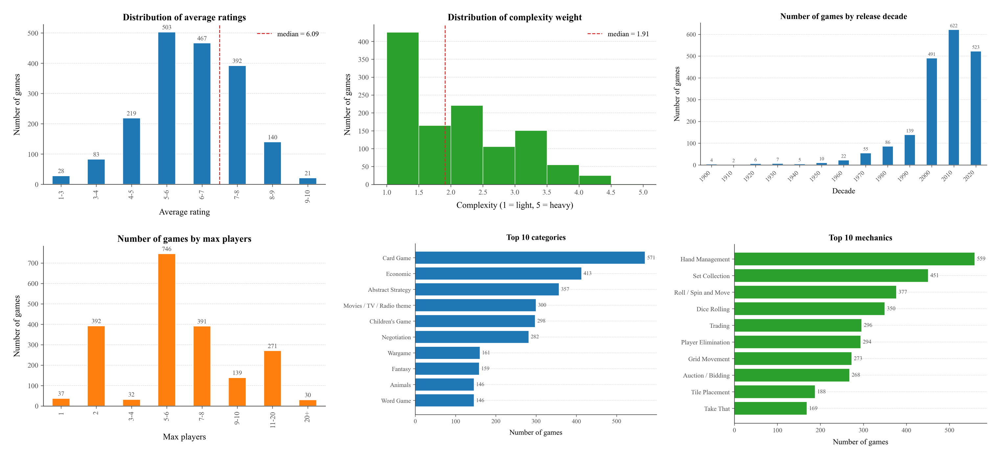
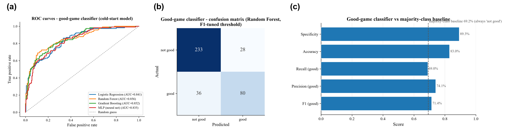
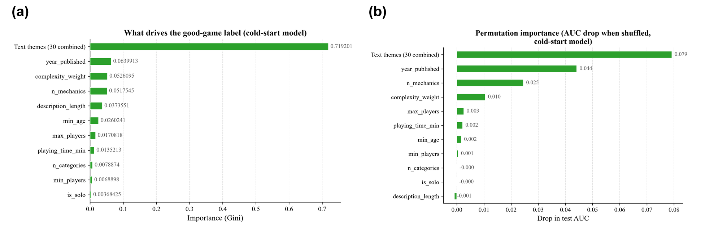

> **Contribution and AI Usage Statement.** The repository's commit history does not reflect individual contributions because familiarity with GitHub varies. All team members contributed equally to the mini project. Code writing, debugging and refining was supported by AI-assisted tools, with all AI-generated output checked and confirmed by the team. More information can be found in the project [README](https://github.com/zauziii/bgg-mini-project/blob/main/README.md).

# Abstract

The board game industry has seen rapid growth, but it is not easy to assess the quality of newly released games until a sufficient number of player ratings have been collected. In this paper, the cold-start problem is addressed using data from BoardGameGeek (BGG). We obtain 2,077 base games from BGG's official XML API2 and predict two complementary outcomes: popularity (via regression, with an R$^2$ of approximately 0.73) and quality (via binary classification, achieving a test AUC of up to 0.856). Our predictions are based on a set of 10 structured attributes and 30 latent text components that are extracted from the game descriptions. The text block is the most important indicator of quality (accounting for 71% of the Gini importance; when it is shuffled, the test AUC drops by 0.079), whereas description length serves only as a redundant proxy. Having adjusted the decision threshold according to the precision-recall curve, the model achieves an F1 score of 0.71, compared to a majority-class baseline of 69.2%, matching the performance of a variant prone to leakage that included popularity as a feature. The predictions are provided as an interpretable content-based recommender and an interactive Streamlit app.

**Keywords**: cold-start problem, recommender systems, text mining, board games, interpretability.

# 1. Introduction

The board game industry has seen considerable growth, with BoardGameGeek (BGG) now having more than 100,000 games and millions of ratings from its community. But for new or specialized games with only a few ratings, there are few aggregated signals. As a result, recommendation systems face the cold-start problem and must rely entirely on item attributes when there is no interaction history [@schein2002coldstart; @melville2002contentboosted].

We see this as a cold-start prediction problem: can we predict whether a game will be well received from attributes alone, without any rating data? The work is divided into three parts. First, we construct a reproducible data pipeline that collects 2,077 base games from the BGG XML API. Second, we conduct prediction studies on features without rating information: regression for popularity and classification for quality, with rigorous evaluation and two methods to assess feature importance. Third, we deploy the results via an interpretable recommender and an interactive web app to deliver the analyses to the end users.

Taken together, the project answers two linked questions. One is the analytical question fundamental to this report: what makes a board game great? The other is practical: how can that knowledge actually help a player choose? The web application, Board Game Finder, bridges the two. It turns the modeling findings, including signal quality and its trade-offs, into an interpretable recommendation tool. It was built around a simple mission: turn winter nights into game nights. 

# 2. Methods

## 2.1 Data collection and Preprocessing

Data were collected using the official BGG XML API2 with a personal developer token. The seeds were from '/hot', 52 hand-picked '/search' terms (euro, family, party, abstract, thematic games) and '/thing' calls with 20 ids per batch and `stats=1`. We rate-limited requests to 1 every 3.5s, backed off on 429/5xx errors, and cached each raw response. The dataset contains 2,077 games and 26 columns. Only base games. Columns are: name, year, player numbers, playtime, age, weight of complexity, ratings, rank, categories, mechanics, designers, and description.

Prior to modeling, we imputed missing structured numeric values with medians, removed HTML from descriptions, and applied TF-IDF (1500 terms, English stop-words) [@salton1988termweighting]. We then reduced the matrix with truncated SVD [@deerwester1990latentsemantic] to 30 latent "text topics". The last set of features contains 10 structured features and 30 text features. To avoid leaking popularity into a quality-prediction model, we intentionally excluded both the number of ratings and the predicted rating.

## 2.2 Learning Tasks and Evaluation

Task 1 (regression). Predict popularity as `log1p(users_rated)`, evaluated with R$^2$ on an 80/20 stratified hold-out (random_state = 42; primary); the raw average rating is a secondary target assessed by mean absolute error (MAE).

Task 2 (classification). Predict the binary label good game (average rating $\geq$ 7); after excluding 197 games without an average rating, 30.9% of the 1,880 supervised games are positive. Four classifiers (Logistic Regression, Random Forest with class_weight='balanced' [@breiman2001randomforests], Gradient Boosting [@friedman2001greedy], MLP) were compared under 5-fold stratified cross-validation (AUC) and an 80/20 stratified hold-out (test AUC, F1, accuracy; random_state = 42). Because the 0.5 threshold favors the majority class, the decision threshold was tuned to maximize F1 on the precision–recall curve. Feature importance was assessed with Gini importance [@breiman2001randomforests] and with permutation importance [@altmann2010permutation] (the 30 text components permuted as one block, since correlated components would otherwise underestimate the text contribution).

Task 3 (recommender). An interpretable rule-based recommender scores each game against a user's group size, playtime, and complexity preferences: `0.35·players + 0.20·playtime + 0.20·complexity + 0.25·rating/10`, with a quality floor of $\geq$ 100 ratings. A second module computes similar games via Jaccard similarity on categories + mechanics, excluding same-series editions.

## 2.3 Ethics and Privacy

All data is comprised of public aggregates, so no personal information is present. Ratings fulfill two distinct purposes: providing a quality threshold for recommendations in the product logic, and serving as a target for predictions in the modeling. They are never employed as an indicator.

# 3. Results

## 3.1 Dataset and Exploratory Analysis

After being cleaned, the dataset contains 2,077 base games and 26 columns. The majority of the missing values are found in the crowd-sourced fields: for many of the older games, the board_game_rank and bayes_rating are missing (1,333 and 1,272 rows, respectively); complexity_weight is missing for 927 games; and playing_time_min is missing for 402 games. The min_age field is complete, however. The median average rating is 6.09 on a scale of 10. 503 of the games have ratings between 5 and 6, whereas only 21 have ratings in the 9-10 range. Community data suggests that the typical game has medium-to-light complexity (median complexity weight 1.91) and relatively short playtime. The highest number of releases was in the 2010s (622 games) and the 2020s (523 games). The most frequently available games are those for 5 to 6 players (746) and for 2 players (392). The largest category is Card Game (571), and the most common mechanic is Hand Management (559). Games that allow solo play tend to have higher average ratings (median about 7.4, compared to about 6 for those that do not allow solo play). There is a moderate correlation between complexity and average rating (r = 0.50). These patterns are used to inform the modeling decisions and to set the default profiles for the recommender system.

{#fig-eda width=95%}

## 3.2 Regression: Predicting Popularity

When rating-free features are used, the regression of `log1p(users_rated)` achieves an R$^2$ of approximately 0.73 (Gradient Boosting gives 0.729, Random Forest 0.717, linear models 0.479, and MLP 0.297): this shows that popularity can mainly be explained by the type of game rather than simply by how it was received. With respect to the secondary target—predicting the raw average rating—the R$^2$ value is naturally low since the ratings are noisy and confined to a small range; the more honest measure is the mean absolute error, for which Random Forest performs best with 0.739 rating points (Gradient Boosting has 0.779, linear models 0.85, and MLP 1.231).

## 3.3 Classification: Predicting Quality

```{=latex}
\begin{table}[H]
\centering
\small
\begin{tabular}{lcccc}
\toprule
Model & CV AUC & Test AUC & F1 (0.5) & Accuracy (0.5) \\
\midrule
Logistic Regression & 0.860 & 0.841 & 0.632 & 0.753 \\
Random Forest       & 0.879 & \textbf{0.856} & 0.608 & 0.798 \\
Gradient Boosting   & 0.866 & 0.852 & 0.651 & 0.806 \\
MLP (neural net)    & 0.859 & 0.835 & 0.661 & 0.798 \\
\bottomrule
\end{tabular}
\caption{Classification results (good game = rating $\geq$ 7; cold-start features; metrics at the default 0.5 threshold).}
\label{tbl-class}
\end{table}
```

Each of the four models achieves a test AUC > 0.83 in the absence of rating-derived features; Random Forest achieves the highest held-out AUC, 0.856 (Figure 2(a)).

{#fig-eval width=95%}

Threshold tuning. The Random Forest can be improved to F1 = 0.71, accuracy 83.0% by optimizing the threshold on the precision–recall curve (optimum 0.50). This nearly matches the leakage-prone version that included users_rated (F1 = 0.717); no popularity data is used, and the gain comes from threshold selection alone. The tuned model improves accuracy, recall, precision and F1 over the 69.2% majority-class baseline (Figure 2(c)).

What drives the label. Description text themes constitute 71% of importance (Figure 3(a), Gini importance, text components combined). The most powerful structural factors are the year of publication (0.064), complexity weight (0.053), and number of mechanics (0.052). Figure 3b (permutation importance) supports the text block as the most powerful signal (AUC decrease 0.079) and indicates that description length is redundant: permuting marginally increases AUC (−0.001), as its information is embedded in the text themes. `is_solo` is almost meaningless in the Gini ranking (0.004): solo support does not predict quality.

{#fig-imp width=95%}

## 3.4 Recommender/Finder and Web Application

The web app has one aim: turn winter nights into game nights. During Finland's long winter evenings, it is meant to make choosing a game easier. The recommender gives clear suggestions for each profile. Examples include Quick & easy (4 players, $\le$ 45 min, complexity $\le$ 2.5/5), Take your time (4 players, $\le$ 120 min), and Five at the table (5 players, $\le$ 90 min). Every suggestion includes a brief note explaining why it meets the criteria you selected. The exported score and similarity tables power a Streamlit app with four pages: Find a game, Explore the data, Similar games, and Board Game Bestiary. The Bestiary is an eight-question quiz that maps players to a game-night creature and returns three real recommendations from the 2,077-game dataset. This app is our primary way to reach our audience of casual and hobbyist players.

# 4. Discussion

Cold-start framing. We frame game-quality classification as a cold-start problem, consistent with its intended application (recommending games the user has not played) and avoiding circular reasoning. The trade-off is worth it: we lose popularity signals such as users_rated, and the default 0.5 threshold, a poor fit for a 30.9% positive class, is fixed by tuning on the precision–recall curve.

Text is the primary signal. Both importance techniques agree: description text dominates, ahead of the curated metadata features. Permutation also flags description length as a redundant proxy, confirming the signal comes from text content, not length.

Limitations. BGG ratings are from a self-selected, enthusiast sample; complexity is a community estimate; text is English only; recommendations are content-based, not personalized beyond the three preference sliders; the recommender's quality term needs existing ratings, so for truly unreleased games the classification model is the fallback; hyperparameters were kept deliberately simple rather than tuned (e.g., RF with 300 trees, MLP with two hidden layers).

Ethics. As described in §2.3, ratings are never utilized as predictors.

# 5. Conclusion

The quality and popularity of board games can be predicted from intrinsic, rating-free information alone, such as structured attributes and descriptive themes. Our classification model achieved an AUC of 0.856, and our regression model an R$^2$ of about 0.73. Both importance methods agree that description text is the strongest signal. We packaged these results into a recommender and an interactive web app players can use directly. Future work could add user-level data, support for multiple languages, and automatic hyperparameter tuning.

# 6. Data and Code Availability

The project code is at https://github.com/zauziii/bgg-mini-project. Data is derived from the public BGG XML API2 (data © BoardGameGeek) and is reproducible using `fetch_bgg.py` and `clean_bgg_data.py`. To guarantee reproducibility, the scripts `run.bat`, `clean.bat`, `ml.bat` and `run_webapp.bat` are executed on Windows (Anaconda or system Python). Equivalent shell commands are given in README.

# References

